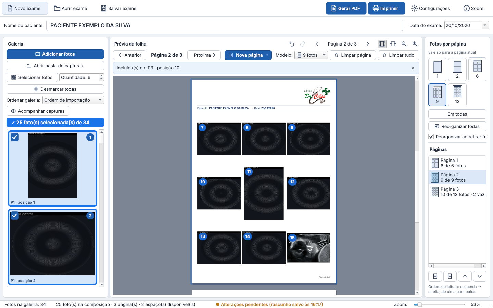
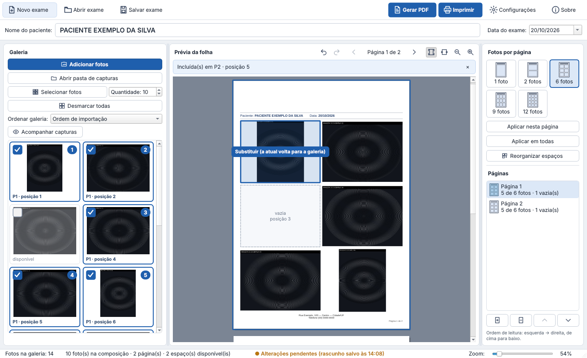

# Galeria Pro Clínica 1.3

> ## ⬇️ Download — versão 1.3.1 (atual)
>
> **[GaleriaProClinica-Setup-1.3.1.exe](https://github.com/celsomatosjunior/Galeria-pro/raw/main/instaladores/v1.3.1/GaleriaProClinica-Setup-1.3.1.exe)** — instalador único, Windows 10/11 64 bits (22 MB).
> SHA-256: `95e25b0bec339cc0b4972013b3226834ae2659f1119c6c8311cb36d498c3a558`
>
> Versão portátil: [GaleriaProClinica-Portatil-1.3.1.zip](https://github.com/celsomatosjunior/Galeria-pro/raw/main/instaladores/v1.3.1/GaleriaProClinica-Portatil-1.3.1.zip) — SHA-256: `c679dad7706a0eadf0f811c1a9a06a625b45a079ef2482e708e45deba0ed5318`
>
> [Notas da 1.3.1 e como atualizar](instaladores/v1.3.1/LEIA-ME.md) · [Manual](docs/MANUAL.md) · [Relatório de testes](docs/RELATORIO-DE-TESTES.md) · [Avisos de terceiros](instaladores/v1.3.1/AVISOS-DE-TERCEIROS.md)
>
> Versões anteriores: [1.3.0](instaladores/v1.3.0) · [1.2.0](instaladores/v1.2.0) · [1.1.0](instaladores/v1.1.0)

Organiza as fotografias de exames, monta folhas A4 com a identidade visual da clínica (logo,
paciente, data e rodapé) e **imprime ou gera PDF**. Complementar ao **Capture Pro**: acompanha a
pasta de capturas, sem alterar aquele programa. Funciona **100% offline**: sem login, sem internet.

## Novidades da 1.3.1
- **Correção das piscadas contínuas da galeria** que apareciam na 1.3.0 (ver [notas](instaladores/v1.3.1/LEIA-ME.md)).

## Novidades da 1.3
- **Cada página tem o seu modelo** (ex.: 6, depois 9, depois 12); o seletor vale só para a página atual.
- Reduzir o modelo **nunca altera as outras páginas** (pergunta o que fazer com as que sobram).
- Navegação: Anterior · Página X de Y · Próxima · **Nova página** · Modelo · **Limpar página** · **Limpar tudo** (Ctrl+Z desfaz).

## Novidades da 1.2
- **Um clique** na miniatura seleciona, outro desmarca; **duplo clique** amplia sem mudar a seleção.
- Seleção bem visível (borda e fundo azuis, ✔, número) e **contador** de fotos selecionadas.
- Ao retirar uma foto, as seguintes **sobem automaticamente** (opção; pode deixar o espaço vazio).
- **Números das posições** na prévia (só na tela).

## Novidades da 1.1
- **Galeria e impressão independentes**: ordenar a galeria não muda a impressão, e vice-versa.
- **Selecionar fotos + Quantidade** (total): ex. 6 por página e 10 fotos → 6 + 4, com 2 células vazias.
  Com composição existente: *Completar*, *Refazer* ou *Cancelar*.
- **Células com posição** (“P2 · posição 4”), **lacunas** ao retirar uma foto e
  **Reorganizar e preencher espaços** para fechá-las.
- **Arrastar** mostra o que vai acontecer (colocar, mover, trocar, substituir); tudo também pelo menu.
- Exames da 1.0 abrem com a mesma impressão (cópia de segurança do arquivo original ao salvar).

## Instalação
1. Baixe o instalador (link acima) e execute. Ele pede permissão de administrador.
2. Se o Windows mostrar “O Windows protegeu o computador” (sem assinatura digital paga):
   *Mais informações → Executar assim mesmo*.
3. **Atualizar**: execute o instalador novo por cima da versão anterior. Exames e configurações
   são mantidos (é criada uma cópia de segurança das configurações).
4. Desinstalar não apaga exames nem configurações.

Tudo vem incluído (não é preciso instalar Python nem outra ferramenta).

## Modelos de página
1 foto · 2 fotos (uma em cima da outra) · 6 fotos (2×3) · 9 fotos (3×3) · 12 fotos (3×4).
Modelos diferentes podem ser usados no mesmo exame. As fotos nunca são deformadas nem cortadas
automaticamente; no PDF entram sem perda (JPEG original byte a byte).

## Testes
126 testes automatizados (Linux), incluindo estabilidade visual (sem piscadas), instalação/atualização 1.0 → 1.1 → 1.2 → 1.3 → 1.3.1 e autoteste do programa
instalado em Windows simulado (Wine). **Ainda não validado em Windows real nem em impressora
física** — ver o [relatório de testes](docs/RELATORIO-DE-TESTES.md).

---
Distribuição gratuita do instalador; código-fonte proprietário (ver [LICENCA.md](LICENCA.md)).
