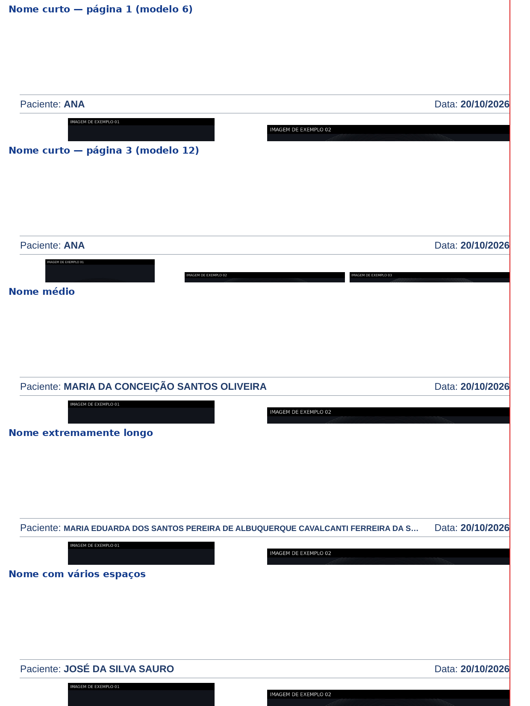

# Galeria Pro Clínica 1.4.1 — data fixa no cabeçalho e novo “Sobre”

Ajustes pontuais. Seleção de fotografias, reutilização, modelos de página, navegação,
salvamento, PDF sem perda e impressão não foram alterados.

## 1. Data do exame em posição fixa
- O cabeçalho tem **duas áreas independentes**: à esquerda **Paciente: nome**; à direita
  **Data: DD/MM/AAAA**, com a extremidade direita presa à **margem direita da área útil** —
  o mesmo limite direito das fotografias.
- A data **não depende do nome**: nome curto, longo, com espaços extras ou alterado — a data fica
  exatamente no mesmo lugar, em todas as páginas e em todos os modelos.
- Nome muito longo: só o nome é ajustado, dentro da área dele — primeiro a fonte é reduzida um
  pouco (até 80%), depois o fim é encurtado com “…”. O nome **nunca** invade a área da data e o
  cabeçalho continua com uma linha só (as fotos não mudam de lugar).
- Margens, fonte, cores e identidade visual configuradas são respeitadas. A mesma regra vale na
  prévia, no PDF e na impressão (é a mesma função de desenho).

## 2. Novo texto em “Sobre”
O ícone “i” (Sobre) mostra o texto de apresentação do Galeria Pro Clínica e de seu autor,
Dr. Celso Matos Junior. A linha “Versão X — ano” é lida do próprio programa: mostra sempre a
versão instalada. Uma linha pequena ao final indica onde estão as licenças dos componentes de
terceiros (aviso exigido pela licença LGPL do Qt).

## Também
- Texto de ajuda da janela “Escolher foto para esta posição” atualizado para a regra da 1.4
  (escolher uma foto já usada coloca mais uma ocorrência).
