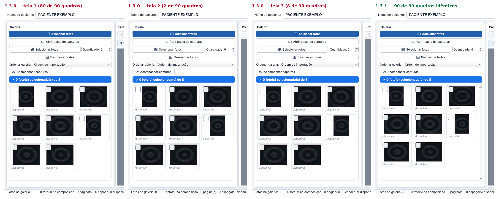

# Galeria Pro Clínica 1.3.1 — correção das piscadas

Versão de correção da 1.3.0. **Recomendada para todos que instalaram a 1.3.0.**
Mantém todas as funções da 1.3.0 (modelo próprio por página, Limpar página / Limpar tudo,
navegação, Nova página, seleção com um clique, duplo clique para ampliar, PDF sem perda).

## O que foi corrigido
Na 1.3.0, com poucas fotos e a janela maximizada, a **galeria piscava sem parar**: ela alternava
entre 2 e 3 colunas centenas de vezes por segundo, porque a barra de rolagem aparecia e sumia
a cada troca. Agora a barra de rolagem da galeria fica sempre presente e a grade só muda quando
a largura da galeria muda. Com o programa parado, o uso do processador caiu de ~84% para ~1,6%
de um núcleo nessa situação.

Detalhes técnicos: [notas da versão](../../docs/NOTAS-DA-VERSAO-1.3.1.md) ·
[relatório de testes](../../docs/RELATORIO-DE-TESTES.md).

## Como atualizar
Feche o programa e execute `GaleriaProClinica-Setup-1.3.1.exe` por cima da versão instalada.
Exames e configurações são mantidos (cópia de segurança `config.backup-antes-v1.3.1.json`).
