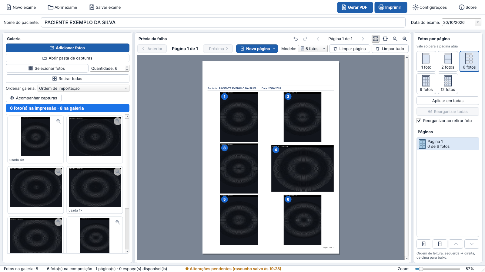

# Galeria Pro Clínica 1.4.0 — fotografias reutilizáveis

**Uma foto da galeria pode ser usada quantas vezes você quiser.** Cada clique na miniatura
coloca a foto mais uma vez na página atual — várias vezes na mesma página e em páginas
diferentes. Dez cliques = dez ocorrências. A miniatura não fica marcada nem bloqueada (só um
texto discreto “usada N×”). O arquivo não é duplicado no disco.

## Como usar
- **Colocar**: clique na miniatura (cada clique = mais uma vez). Página cheia → página nova no final.
- **Retirar uma ocorrência**: clique nela **na prévia** e tecle **Delete** (só ela sai).
- **Retirar todas as ocorrências de uma foto**: botão direito na miniatura.
- **Ampliar**: a **lupa** no canto da miniatura (ou duplo clique na prévia).
- **Selecionar fotos** (automático) continua usando fotos diferentes.

Mantém tudo da 1.3.1: modelo próprio por página (1, 2, 6, 9, 12), Nova página, Limpar página,
Limpar tudo, arrastar, trocar, substituir, desfazer, salvamento automático, PDF sem perda e a
correção das piscadas. Detalhes: [notas da versão](../../docs/NOTAS-DA-VERSAO-1.4.0.md) ·
[relatório de testes](../../docs/RELATORIO-DE-TESTES.md) · [manual](../../docs/MANUAL.md).

## Como atualizar
Feche o programa e execute `GaleriaProClinica-Setup-1.4.0.exe` por cima da versão instalada.
Exames e configurações são mantidos (cópia de segurança `config.backup-antes-v1.4.0.json`).
Exames com foto repetida só abrem na 1.4 ou mais nova.
